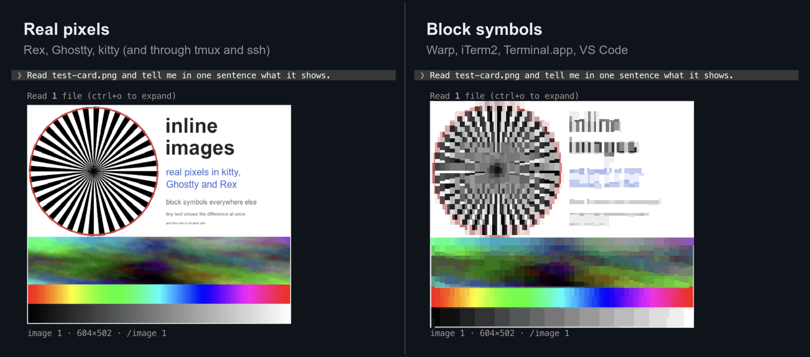

# inline-images

[](https://github.com/STiXzoOR/claude-inline-images/actions/workflows/ci.yml)
[](https://github.com/STiXzoOR/claude-inline-images/releases)
[](https://code.claude.com/docs/en/plugins/mods/overview)
[](LICENSE)

A Claude Code mod that draws images in the terminal transcript, under the row they belong to, instead of leaving you with `[Image #1]`.



<sub>Real captures from Rex: the left with `CLAUDE_CODE_FORCE_TERMINAL_IMAGES=1`, the right without it, which is what Warp, iTerm2 and Terminal.app get. See [docs/media](docs/media/README.md).</sub>

- **Every image in the conversation:** the ones you paste or drag in, the ones tools return (a `Read` of a picture, browser screenshots, MCP images) and the files Claude sends you with `SendUserFile`. They come back when you `--resume` or `--continue`.
- **Real pixels** in kitty, Ghostty and Rex, including inside tmux and over ssh.
- **Block symbols everywhere else:** each cell picks the closest of 24 block glyphs and two colours, so shapes and colour survive in any truecolor terminal.
- **A lightbox:** `/image N`, or a click on a caption, opens a picture big. Step through the conversation's pictures, zoom toward the pointer with the wheel or trackpad, drag to pan.

Without it, Claude Code shows only this:

```
❯ Read test-card.png and tell me in one sentence what it shows.

  Read 1 file (ctrl+o to expand)

⏺ It's a test card for checking inline image rendering: a black-and-white radial sunburst …
```

## Install

At the prompt of a Claude Code terminal session:

```
/plugin install inline-images --marketplace STiXzoOR/claude-inline-images
```

Answer `y` to add the marketplace, then pick a scope (user is the usual one).

<details>
<summary>From a shell, or in the desktop app</summary>

```bash
claude plugin install inline-images --marketplace STiXzoOR/claude-inline-images
```

In the desktop app, where `/plugin` does not run: click + next to the prompt box, then Plugins, Add marketplace with `STiXzoOR/claude-inline-images`, then Add plugin.

</details>

Update with `claude plugin update inline-images@claude-inline-images`, then restart Claude Code.

### Needs

- **Claude Code 2.1.311 or later.** Mods are on by default since 2.1.287. CI tests 2.1.311 and the latest release.
- **ImageMagick 7 (`magick`)** to decode. On macOS the built-in `sips` stands in when it's missing. On Ubuntu, the `imagemagick` package is version 6, which has no `magick`: use the official AppImage from the ImageMagick releases, extracted with `--appimage-extract` so it needs no FUSE.

## The lightbox

`/image 3` opens image 3, `/image` the latest, and `/image list` lists them. A click on a picture's caption opens it too.

| | Keys (no click needed) | Mouse and trackpad |
|---|---|---|
| Previous, next | `p` `n` | `❮` `❯`, a thumbnail or its number |
| Zoom | `z` `x` | the wheel or a two-finger scroll, toward the pointer |
| Pan | `w` `a` `s` `d` | drag the picture |
| Fit | `f` or `0` | |
| System viewer | `v` | |
| Close | Esc or `q` | `✕ close` |

With real pixels, a click on the picture also gives it ← → to step and + − to zoom.

While you're zoomed in, a navigator in the top right corner shows the whole picture with the part in view boxed in orange. Past the picture's own resolution, pixels stay sharp squares rather than blurring.

- **Clicks and drags need Claude Code's fullscreen layout** (`/tui fullscreen`), where the lightbox docks beside the transcript. In the default layout it sits above the prompt and the keys and wheel drive it.
- **Block symbols take no drags or clicks on the picture.** Anything laid over a `Raster` blanks it, so there the wheel, the keys and the buttons drive.
- A mod can't cover the whole screen. For that, press `v`.
- Zoom needs ImageMagick (`magick`); with only `sips` the lightbox shows the picture at fit.

## Where it draws pixels

| Terminal | Draws | Needs |
|---|---|---|
| Ghostty, kitty 0.28+ | Real pixels | Nothing |
| Rex | Real pixels | `CLAUDE_CODE_FORCE_TERMINAL_IMAGES=1` |
| tmux, ssh, from one of the above | Real pixels | `CLAUDE_CODE_FORCE_TERMINAL_IMAGES=1` on the far side, and `set -g allow-passthrough on` in tmux |
| Warp, iTerm2, Terminal.app, VS Code | Block symbols | Nothing |

Claude Code draws real pixels only in terminals whose XTVERSION name is kitty or Ghostty. Rex supports everything the `Image` element needs (kitty images and Unicode placeholders), but it names itself `rex`. Over ssh or inside tmux, Claude Code can't ask the terminal outside what it draws. In both cases the override tells it.

Set the override only where the terminal can draw the images, never in the `env` block of `~/.claude/settings.json`. There it applies in every terminal, and in one that can't draw them, images break instead of falling back to block symbols. A shell alias can set it per terminal, for example only in Rex:

```bash
alias clauded='CLAUDE_CODE_FORCE_TERMINAL_IMAGES=$([[ $TERM_PROGRAM == rex ]] && echo 1) claude'
```

On a server you reach from such a terminal, set it in that server's alias unconditionally.

Warp draws kitty images sent inline, but not the Unicode placeholders `Image` relies on ([warpdotdev/warp#16312](https://github.com/warpdotdev/warp/pull/16312) adds them). It stays on block symbols. Last checked on Warp v0.2026.11.11.

## Settings

`/plugin configure inline-images@claude-inline-images`, or from a shell `claude plugin configure inline-images@claude-inline-images`:

| Setting | Default | |
|---|---|---|
| `renderer` | `auto` | `auto` picks pixels or symbols as above. `symbols`, `blocks` (plain half blocks) or `pixels` force one. |
| `maxColumns` | 64 | The widest a picture is drawn, in columns. |
| `maxRows` | 22 | The tallest, in rows. Raise both for more detail in block symbols. |

## What it runs

The mod reads the conversation's images, decodes them and draws them. It makes no network or model calls. It runs these programs:

- `magick` to decode a picture to a PNG and a 480-pixel RGBA copy, or on macOS without ImageMagick, `/usr/bin/sips` and `/usr/bin/base64`
- `sh -c 'base64 -d >"$1"'` to write a pasted image to a file first, since ImageMagick 7.1.2 and later refuse a data URI on stdin
- `mkdir -p` and `find <cache> -type f -mtime +7 -delete` for its cache in `$TMPDIR/claude-inline-images`
- `magick <picture> -crop …` when you zoom in the lightbox
- `open` (macOS) or `xdg-open` (Linux) when you press `v` in the lightbox

Decodes are named by content, so a picture seen twice is decoded once.

## Troubleshooting

- **Block symbols in Rex, or in tmux under Ghostty.** Claude Code doesn't know the terminal draws images: set `CLAUDE_CODE_FORCE_TERMINAL_IMAGES=1` (see the table).
- **A blank box where the picture should be.** The terminal was sent a file it can't open. Since 0.2.2, the mod sends the picture's bytes whenever it runs inside tmux or over ssh. Update, and check that tmux has `allow-passthrough on`.
- **Washed-out colours inside tmux.** Claude Code limits itself to 256 colours in tmux. Set `CLAUDE_CODE_TMUX_TRUECOLOR=1`, and tell tmux your terminal has truecolor: `set -as terminal-features "<your $TERM>:RGB"`.
- **No picture under the row.** Nothing could decode it, so the mod leaves the row as Claude Code drew it. Install ImageMagick 7 so that `magick` is on `PATH`.
- **Nothing drawn at all.** Check `claude --version` (2.1.311 or later) and that `/plugin` lists `inline-images` as enabled. Restart Claude Code after an install or update.

## How it works

The mod hooks the transcript rows that hold images (`UserMessage`, `ToolResult`, `ToolGroup`) and draws each picture below the row Claude Code drew. For real pixels it hands Claude Code's `Image` element the picture. On the same machine as the terminal, that's the file's path. Inside tmux or over ssh, it's the PNG's bytes (or past the 2 MiB an `Image` takes, the 480-pixel copy), because a terminal on another machine can't open a path on this one. For block symbols it renders the 480-pixel copy into a `Raster` of cells, each one the closest of 24 glyphs (halves, quadrants, eighths) in two colours, averaged in linear light.

## Develop

The mod lives in [`plugins/inline-images/`](plugins/inline-images). Claude Code runs the copy it installs under `~/.claude/plugins/cache/`, so to try a change, load the clone's mod for one session: `claude --plugin-dir plugins/inline-images`.

```bash
claude plugin validate .                      # the marketplace
claude plugin validate plugins/inline-images  # the mod
claude plugin test plugins/inline-images
tsc -p plugins/inline-images --noEmit         # its types folder appears once Claude Code has loaded the mod from there
```

[`examples/make-test-card.sh`](examples/make-test-card.sh) draws [`examples/test-card.png`](examples/test-card.png), the card in the screenshot. Ask Claude to read it.

## Credits

The rule for where Claude Code draws real pixels follows [jarrodwatts/claude-image-view](https://github.com/jarrodwatts/claude-image-view) (MIT).

## License

[MIT](LICENSE). Changes are in the [changelog](CHANGELOG.md).
